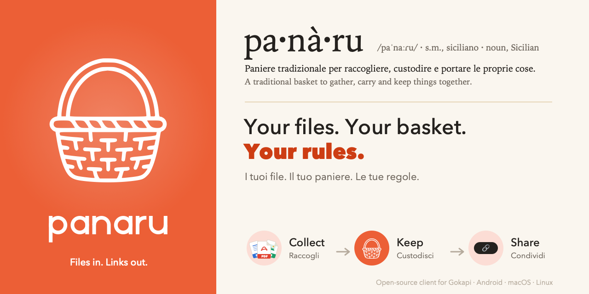

<p align="center">
  
</p>

<h1 align="center">Panaru</h1>

<p align="center">
  <b>Your files. Your basket. Your rules.</b><br>
  <i>I tuoi file. Il tuo paniere. Le tue regole.</i>
</p>

<p align="center">
  Android · macOS · Linux · Self-hosted · Privacy-first · Open source
</p>

<p align="center">
  <a href="#english">English</a> · <a href="#italiano">Italiano</a> · <a href="#funzionalità--features">Funzionalità / Features</a>
</p>

Panaru is a lightweight, open-source, cross-platform client for [Gokapi](https://github.com/Forceu/Gokapi),
designed to make self-hosted file sharing feel effortless.
**Collect files. Keep them under your control. Share them with a link.**

---

<a name="english"></a>
## 🇬🇧 English

### A little piece of Sicily, reimagined

The name **Panaru** comes from Sicilian: it is the traditional basket used to gather, carry and keep
things together.

A *panaru* is a simple, everyday object with a clear purpose. It brings different things together,
makes them easy to carry and lets you share them with others. We thought it was the perfect metaphor
for file sharing.

In the digital world, Panaru does exactly that: it gathers your files, keeps them within your own
infrastructure and turns them into links you can share whenever you need. Just like a traditional
basket, it doesn't need to be complicated. It simply needs to work.

### Your files. Your infrastructure.

File sharing shouldn't mean giving up control of your data. Panaru connects to your own
[Gokapi](https://github.com/Forceu/Gokapi) server, giving you a simple and intuitive way to upload,
manage and share files without depending on third-party cloud platforms.

No unnecessary complexity. No forced subscriptions. No external cloud required.
**Gokapi takes care of the infrastructure. Panaru takes care of the experience.**

### Designed to stay out of your way

Panaru is built around one simple idea: sharing a file should take as little effort as possible.

- **Self-hosted** — connect to your own Gokapi server.
- **Privacy-first** — your files and your infrastructure stay under your control. No analytics, no tracking.
- **Cross-platform** — native apps for Android, macOS and Linux.
- **Fast and lightweight** — focused on doing one thing well.
- **Open source** — transparent, community-driven and built to be improved.
- **Seamless sharing** — every upload becomes a shareable link, copied for you.

### More than a file uploader

Panaru is not another cloud storage service. It is the missing everyday interface between you and
your self-hosted file-sharing server. You shouldn't have to think about servers, endpoints or upload
procedures — only about the file you want to share.

> **Files in. Links out.**
> Panaru — a Sicilian idea for sharing files your way. Built for Gokapi. Made for your own infrastructure.

<a name="italiano"></a>
## 🇮🇹 Italiano

### Un piccolo pezzo di Sicilia, reinterpretato in chiave digitale

Il nome **Panaru** nasce dal siciliano: è il paniere tradizionale, il cesto usato per raccogliere,
custodire e trasportare le proprie cose.

Il *panaru* è un oggetto semplice, familiare e concreto. Serve a mettere insieme cose diverse, a
portarle con sé e, quando serve, a condividerle con gli altri. Abbiamo trovato in questo oggetto una
metafora perfetta per la condivisione dei file.

Nel mondo digitale, Panaru fa proprio questo: raccoglie i tuoi file, li mantiene all'interno della
tua infrastruttura e li trasforma in link pronti da condividere. Come il paniere della tradizione,
non ha bisogno di essere complicato: deve semplicemente fare bene il suo lavoro.

### I tuoi file. La tua infrastruttura.

Condividere un file non dovrebbe significare rinunciare al controllo dei propri dati. Panaru si
collega al tuo server [Gokapi](https://github.com/Forceu/Gokapi) e offre un modo semplice e intuitivo
per caricare, gestire e condividere file, senza dipendere da piattaforme cloud di terze parti.

Niente complessità inutili. Nessun abbonamento obbligatorio. Nessun cloud esterno.
**Gokapi si occupa dell'infrastruttura. Panaru si occupa dell'esperienza.**

### Progettato per non intralciarti

Panaru nasce da un'idea precisa: condividere un file deve richiedere il minimo sforzo possibile.

- **Self-hosted** — collegati al tuo server Gokapi.
- **Privacy al primo posto** — file e infrastruttura restano sotto il tuo controllo. Nessuna analitica, nessun tracciamento.
- **Multipiattaforma** — app native per Android, macOS e Linux.
- **Leggero e veloce** — fa bene una cosa sola, senza complicazioni.
- **Open source** — trasparente, aperto e migliorabile dalla community.
- **Condivisione immediata** — ogni caricamento diventa un link, già copiato per te.

### Più di un semplice strumento per caricare file

Panaru non è un altro servizio di archiviazione cloud. È l'interfaccia quotidiana che mancava tra te
e il tuo server di condivisione file. Non dovresti preoccuparti di server, endpoint o procedure di
caricamento: dovresti pensare soltanto al file che vuoi condividere.

> **Files in. Links out.**
> Panaru — un'idea siciliana per condividere i file a modo tuo. Basato su Gokapi. Pensato per la tua infrastruttura.

---

## Funzionalità · Features

| | Android | macOS | Linux |
|---|:---:|:---:|:---:|
| Più server Gokapi, con server predefinito e verifica della connessione | ✅ | ✅ | ✅ |
| API key cifrate (Android Keystore / Portachiavi macOS) | ✅ | ✅ | ✅ (portachiavi) |
| Upload a chunk in streaming, anche di file molto grandi | ✅ | ✅ | ✅ |
| Scadenza, download consentiti, password per upload | ✅ | ✅ | ✅ |
| Coda con concorrenza configurabile, avanzamento, annullamento, retry | ✅ | ✅ | ✅ |
| Link copiato automaticamente + notifica "Link pronto" | ✅ | ✅ | ✅ |
| Cronologia locale con stato (scadenza, download rimasti), eliminazione dal server | ✅ | ✅ | ✅ |
| Condivisione di più link insieme | ✅ | ✅ | — |
| File sul server e download via API | ✅ | ✅ | ✅ |
| **Share Sheet** da qualsiasi app (`ACTION_SEND` / `SEND_MULTIPLE`), senza copiare i file | ✅ | — | — |
| Upload in background con servizio in foreground e notifiche di avanzamento | ✅ | — | ✅ |
| Scorciatoia "Carica file" dal launcher | ✅ | — | ✅ |
| **Drag & drop** nella finestra, sull'icona del Dock e nella barra dei menu | — | ✅ | ✅ (finestra) |
| **Barra dei menu** con stato upload e link recenti | — | ✅ | — |
| Finder: *Apri con → Panaru* e *Servizi → Carica con Panaru* | — | ✅ | "Apri con" dal file manager |
| Cartelle (ogni file contenuto riceve il proprio link) | — | ✅ | ✅ |

Cosa Panaru **non** fa, perché l'API di Gokapi non lo consente: upload riprendibili dopo
un'interruzione, upload cifrati end-to-end, upload di cartelle come archivio unico.
Dettagli in [docs/GOKAPI_API.md](docs/GOKAPI_API.md).

## Requisiti

- Un server **Gokapi ≥ 2.0.1** raggiungibile in HTTPS (HTTP è accettato solo in rete locale).
- Una **API key** creata in Gokapi → *API* con il permesso **Upload**.
  Permessi facoltativi: **View** (stato dei file ed elenco sul server), **Delete** (eliminazione),
  **Download** (download via API).
- Android 8.0+ · macOS 14 Sonoma+ · Linux con GTK 4.14 e libadwaita 1.5 (Ubuntu 24.04, Debian 13, Fedora 40 o successive) e un portachiavi Secret Service.

## Installazione

Non ci sono ancora release pubbliche: per ora si compila da sorgente seguendo
[docs/BUILDING.md](docs/BUILDING.md) (APK Android, `Panaru.app` per macOS, `linux/install.sh` per Linux). Le release firmate
sono in [roadmap](docs/ROADMAP.md).

## Configurazione e uso

1. Apri Panaru → **Aggiungi server**: nome, indirizzo (quello con cui apri Gokapi nel browser)
   e API key. Tocca **Verifica connessione**, poi **Salva**.
2. **Android:** da qualsiasi app *Condividi → Panaru*. Il caricamento parte subito e il link
   finisce negli appunti. Puoi chiudere il foglio: l'upload prosegue in background.
3. **macOS:** trascina file o cartelle nella finestra, sull'icona del Dock o nella barra dei menu.
   Dal Finder: clic destro → *Servizi* → **Carica con Panaru**.
4. **Linux:** trascina i file nella finestra, oppure dal file manager *Apri con → Panaru*.
   Chiudendo la finestra durante un caricamento, Panaru lo completa in background.

Guida completa: [docs/USAGE.md](docs/USAGE.md).

## Documentazione

- [Architettura e decisioni](docs/ARCHITECTURE.md)
- [API Gokapi verificate](docs/GOKAPI_API.md)
- [Sicurezza e privacy](docs/SECURITY_MODEL.md) · [Segnalare una vulnerabilità](SECURITY.md)
- [Compilazione](docs/BUILDING.md) · [Test](docs/TESTING.md)
- [Brand guidelines](brand/guidelines/BRAND_GUIDELINES.md)
- [Roadmap](docs/ROADMAP.md) · [Changelog](CHANGELOG.md) · [Contribuire](CONTRIBUTING.md)

## Struttura

```
android/   App Android (Kotlin, Jetpack Compose) — moduli :core:gokapi, :core:data, :app
macos/     App macOS (Swift, SwiftUI) — PanaruKit + app
linux/     App Linux (Rust, GTK 4 / libadwaita) — libreria + interfaccia; dev/ = prova con Docker
brand/     Logo, icone, palette, linee guida, export
docs/      Documentazione
testenv/   Gokapi di test (Docker)
```

## Privacy

Panaru parla **solo** con i server Gokapi che configuri. Nessuna analitica, nessun crash
reporting remoto, nessun servizio cloud intermedio. La cronologia resta sul dispositivo.

## Licenza

[Apache License 2.0](LICENSE). Panaru è un progetto indipendente e non è affiliato a Gokapi;
Gokapi è distribuito con la propria licenza (AGPL-3.0).

---

<p align="center"><i>Made with care, inspired by Sicily.</i></p>
