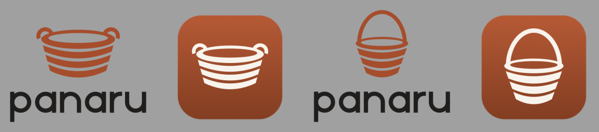

# Panaru — Linee guida del marchio

**Files in. Links out.**

## 1. Significato del simbolo

*Panaru* richiama il **paniere** siciliano: il cesto che raccoglie, custodisce e trasporta.
Il simbolo è una **cesta bassa e larga** ridotta alla sua essenza geometrica:

| Elemento | Forma | Significato |
|----------|-------|-------------|
| Bordo ovale | anello ellittico in prospettiva | l'apertura: il punto in cui i file entrano (*files in*) |
| Due anse laterali | anelli aperti ancorati al bordo | le prese con cui il contenuto viene sollevato e portato via (*links out*) |
| Tre fasce curve rastremate | bande con bordi paralleli | l'intreccio ridotto a ritmo; i file raccolti uno sopra l'altro |
| Fuga costante | lo stesso spazio vuoto separa bordo e fasce | ordine, leggerezza, aria |

Il riferimento siciliano è concettuale: niente texture di vimini, trecce realistiche o
decorazioni. Le curve del bordo e delle fasce dialogano con gli archi delle lettere **n**, **u**
e con i cerchi di **p** e **a** nel wordmark.

## 2. Processo e scelta

La direzione è unica: **il paniere geometrico**. Le proporzioni seguono i riferimenti forniti dal
committente:

1. **Cesta** (simbolo ufficiale) — cesta bassa e larga con bordo ovale e due anse laterali.
   Rapporto ≈ 1,65 : 1. Usata per icone app, logo e materiali.
2. **Paniere** (variante) — manico ad arco alto, corpo più profondo. Rapporto ≈ 0,8 : 1.
   Disponibile in `logo/variants/paniere/` per usi editoriali o come alternativa.

Valutazione:

| Criterio | Cesta | Paniere |
|----------|-------|---------|
| Riconoscibilità | Alta: anse + bordo ovale sono inconfondibili | Alta: il manico è l'archetipo del cesto |
| Piccole dimensioni | Buona con il taglio ottico (2 fasce, anse più spesse) | Buona: il manico regge bene a 16 px |
| Occupazione dell'icona | Orizzontale: lascia aria sopra e sotto, molto riconoscibile in Dock e launcher | Verticale: riempie meglio il quadrato |
| Originalità | Più distintiva: poche app usano una cesta con anse | Più vicina all'icona generica "carrello/cestino della spesa" |

**Scelta: Cesta** come simbolo ufficiale (proporzioni richieste e maggiore distintività);
il **Paniere** resta una variante approvabile.

Per dimensioni ≤ 24 px esiste un **taglio ottico** (`panaru-symbol-small.svg`) con due fasce più
spesse e anse rinforzate, usato in favicon, barra dei menu macOS e notifiche Android.

## 3. Varianti del logo

| File | Uso |
|------|-----|
| `logo/panaru-logo.svg` | Logo principale (simbolo sopra, wordmark sotto) su fondi chiari |
| `logo/panaru-logo-on-dark.svg` | Logo principale su fondi scuri |
| `logo/panaru-horizontal.svg` | Versione orizzontale: header, README, barre |
| `logo/panaru-horizontal-on-dark.svg` | Orizzontale su fondi scuri |
| `logo/panaru-symbol.svg` | Simbolo autonomo |
| `logo/panaru-symbol-small.svg` | Taglio ottico per ≤ 24 px |
| `logo/variants/paniere/*` | Variante "paniere" con manico ad arco |
| `logo/mono/*` | Monocromatiche nero / bianco (stampa, incisione, overlay) |
| `icons/android/panaru-basket.png` | Paniere estratto dall'illustrazione (sorgente delle icone Android) |
| `icons/macos/source/panaru-icon-source.png` | **Icona macOS ufficiale** (illustrazione fornita dal committente, sorgente di `AppIcon.icns`) |
| `icons/macos/menubar/*.svg` | Glifi template per la barra dei menu (normale e "trasferimento in corso"), derivati dall'icona macOS |
| `icons/macos/panaru-macos-icon.svg` | Icona macOS geometrica (cesta), alternativa vettoriale |
| `icons/web/*` | Favicon, icona quadrata, banner README con payoff |
| `exports/*` | PNG e ICNS generati: **non modificarli**, rigenerali |

Tutti gli SVG sono generati da `brand/tools/generate_brand.py` a partire dalla geometria del
simbolo; i raster da `brand/tools/export.sh`. Per modificare il marchio si modifica il generatore,
non i file risultanti.

## 3bis. Icone delle app (Android e macOS) e barra dei menu

L'icona dell'app macOS è l'illustrazione del paniere con manico ad arco su piastra crema
(`icons/macos/source/panaru-icon-source.png`). `tools/macos_icons.py` la porta sulla griglia
Apple (canvas 1024, piastra 824, raggio 185, ombra morbida) e genera l'`.iconset`.

**Android** usa la stessa illustrazione (`tools/android_icons.py`): fondo crema `#FCEED2`, paniere
estratto su trasparenza (le fughe della trama lasciano vedere il fondo) e scalato al massimo
consentito dalla maschera adattiva (pixel più lontano a 34 dp dal centro su 108). L'icona a tema
(Android 13+) è la silhouette con la trama in un solo colore. Anteprima: `android-icon-preview.png`.

Dalla stessa illustrazione deriva il **glifo della barra dei menu** (usato anche come icona delle
notifiche Android): manico ad arco, bordo ovale con
apertura, corpo a due fasce. La trama dell'intreccio è omessa di proposito: a 16–18 pt
diventerebbe una macchia. È un'immagine *template* (nero + alfa) che macOS tinge in chiaro/scuro.
La variante con freccia indica un trasferimento in corso.

Nota: la sorgente è raster (1254 px), sufficiente per tutte le dimensioni dell'icona macOS.
Per usi a grande formato va prevista una ricostruzione vettoriale.

## 4. Wordmark

- Si scrive sempre **panaru**, in minuscolo, anche a inizio frase nei contesti grafici.
  Nel testo corrente è ammesso "Panaru".
- È disegnato a mano: un solo cerchio (r = 20) e un'asta, tratto costante (1/5 dell'altezza x).
  Non sostituirlo con un font e non modificarne la spaziatura.
- Nel lockup orizzontale il simbolo poggia sulla linea di base ed è largo al massimo 110 unità
  (≈ un terzo del wordmark).

## 5. Palette

Fonte unica: [`brand/colors/tokens.json`](../colors/tokens.json). Le app traducono i token in
`Color.kt` (Android) e `PanaruColors.swift` (macOS).

| Token | Hex | Ruolo |
|-------|-----|-------|
| Arancio | `#EC5F36` | Colore del marchio: piastra delle icone (paniere bianco sopra), simbolo, accenti grandi |
| Arancio intenso | `#CD3D13` | Azioni primarie e testo arancio in modalità chiara (bianco sopra 4,9:1) |
| Arancio profondo | `#952D0E` | Pressed, testo su arancio tenue |
| Arancio vivo | `#EE724E` | Primario in modalità scura (su antracite 5,5:1) |
| Arancio tenue | `#FCDDD5` | Superfici tinte, chip selezionati |
| Sabbia | `#E6D5B8` | Neutro caldo, contorni |
| Sabbia tenue | `#F1E7D6` | Superfici secondarie |
| Antracite | `#24211E` | Testo, sfondo scuro |
| Bianco caldo | `#FAF6EF` | Sfondo chiaro |
| Pietra | `#6E665D` | Testo secondario |

Stati (chiaro / scuro): **Successo** oliva `#4F7A52`/`#8DBB8F` · **Errore** melograno
`#A3263A`/`#F08C99` · **Trasferimento** mare `#2F6E7E`/`#7EC0CF` · **Avviso** ocra
`#8C600F`/`#E2B65A`.

Tutte le coppie testo/sfondo previste superano WCAG AA (≥ 4,5:1); i valori sono annotati nei token.
L'arancio è riservato al marchio e alle azioni principali: non usarlo per gli errori.
Il bianco su arancio `#EC5F36` arriva a 3,4:1: va bene per le icone e la grafica, non per testo
piccolo — per pulsanti e testo usare **arancio intenso** (chiaro) o **arancio vivo** (scuro).

## 6. Tipografia

- **Interfaccia:** font di sistema — SF Pro su macOS, Roboto/Google Sans su Android. Nessun font
  incorporato: app più leggere e perfettamente native.
- **Comunicazione (web, README, presentazioni):** Inter o, in mancanza, font di sistema.
  Titoli in peso 600, testo 400. Il payoff si compone in peso 500 con leggera spaziatura (+1%).
- Il wordmark non è mai composto con un font.

## 7. Spaziature e area di rispetto

- **Area di rispetto:** attorno al logo lasciare almeno **metà dell'altezza del simbolo** su ogni lato. Nel lockup orizzontale: almeno l'altezza x del wordmark.
- **Dimensioni minime:**
  - simbolo: 16 px di larghezza (usare il taglio ottico sotto i 24 px);
  - logo orizzontale: 96 px di larghezza;
  - logo principale (verticale): 64 px di larghezza.

## 8. Fondi chiari e scuri

- Fondi chiari (bianco caldo, bianco, sabbia): simbolo arancio, wordmark antracite.
- Fondi scuri (antracite, nero): simbolo arancio vivo, wordmark bianco caldo.
- Fondo arancio: paniere e testo in bianco (è la versione dell'icona app).
- Su fotografie o fondi complessi: versione monocromatica bianca o nera, mai a colori.

## 9. Cosa non fare

- Non ruotare, distorcere, inclinare il simbolo o cambiarne le proporzioni.
- Non aggiungere ombre, contorni, gradienti (eccezione: la piastra dell'icona macOS) o texture di vimini.
- Non riempire gli spazi tra le fasce né cambiarne il numero (salvo il taglio ottico ufficiale).
- Non combinare anse e manico ad arco nello stesso simbolo.
- Non scrivere "PANARU" o "PanAru" nel logo.
- Non usare il simbolo come decorazione ripetuta nelle schermate: compare nel punto d'ingresso
  (icona, schermata vuota, onboarding), non ovunque.

## 10. Applicazione nelle app

- Icona app, schermata vuota/onboarding e "Informazioni" sono gli unici punti in cui appare il logo.
- Gli angoli dell'interfaccia hanno raggi moderati (8–16), coerenti con lo smusso del simbolo.
